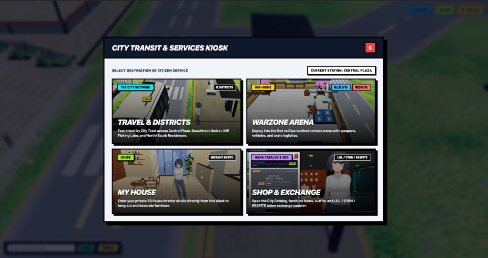
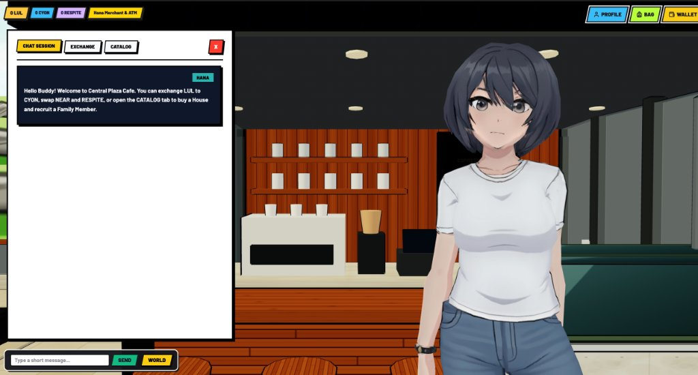
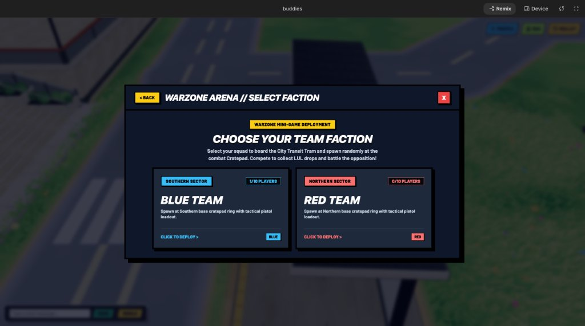

# Buddies Blitz

**A 60 FPS WebGL 3D peaceful social city, Kiosk Portal Hub, interactive Tension-Gauge shoreline fishing system, Modern Japanese Wooden Pavilion interior studio, and separated Red vs. Blue Warzone mini-game built in Three.js & React 19 — powered by seedless NEAR Protocol citizen sub-accounts (`<handle>.buddiesblitz.testnet`), autonomous NPC merchant treasuries, a non-ponzi P2P `RESPITE` (NEP-141) economy, NEP-245 furnishings, and NEP-171 Sub-Account House Deeds & P2P Fish NFTs (`market.buddiesblitz.testnet`).**

- **Live Playable App**: [https://buddies-rouge.vercel.app](https://buddies-rouge.vercel.app)
- **Primary NEAR Hackathon Track**: **`games` — Games With Real Economies (`09-games`)**
- **Secondary NEAR Hackathon Track**: **`nfts` — NFTs That Do Something (`10-nfts`)**
- **On-Chain Smart Contract (NEAR Testnet)**: [`market.buddiesblitz.testnet`](https://testnet.nearblocks.io/address/market.buddiesblitz.testnet) · Master Factory: [`buddiesblitz.testnet`](https://testnet.nearblocks.io/address/buddiesblitz.testnet)


| Main World & Portal Hub | Merchants & 3-Currency ATM |
|---|---|
|  |  |
|  |  |
|  |  |

---

## Why NEAR Protocol Powers Buddies Blitz

Traditional Web3 games break both immersion and tokenomics: they interrupt 60 FPS gameplay with wallet popups, and they mint P2E tokens out of thin air whenever bots grind repetitive tasks. **Buddies Blitz** solves both using native NEAR primitives and a strict player-to-player (`P2P`) real economy:

1. **Seedless Dual-Key Citizen Sub-Accounts (`<handle>.buddiesblitz.testnet`)** — Citizens sign in with Google OAuth (via Privy) and pick a handle, provisioning a browser-scoped Ed25519 `FunctionCall` session key (`0.25 NEAR` gas allowance scoped strictly to `market.buddiesblitz.testnet`) via [`api/near-relayer.ts`](api/near-relayer.ts) while `buddiesblitz.testnet` retains recovery custody. External NEAR wallets (**Meteor Wallet** and **MyNearWallet Testnet**) are also supported with **NEP-413 `signMessage`** cryptographic ownership verification.
2. **Non-Ponzi P2P Real Economy (`Track 09-games`)** — Grinding Mini-Games (**Warzone**) or selling unminted fish to **Merchant Kai** yields off-chain **`LUL`**, whose **sole function** is converting into off-chain **`CYON`** to buy standard non-NFT items. On-chain **`RESPITE` (NEP-141)** is **never printed from gameplay grinding**: it enters circulation only when a player swaps `NEAR -> RESPITE` at **Merchant Hana's** ATM (`1 NEAR = 100 RESPITE`) and circulates **player-to-player** when citizens mint caught fish or rare items as **NEP-171 NFTs** and another player buys them on **Kai's P2P Marketplace** (inspired by *Roblox Fish It* / *Fisch*). If no player buys a listed NFT, zero `RESPITE` is created.
3. **Functional Sub-Account Deeds & Autonomous NPC Merchants (`Track 10-nfts` & `09-games`)** — Purchasing the **Modern Japanese Wooden Pavilion House Certificate (`25 RESPITE`)** mints a **NEP-171 Sub-Account Deed** with atomic `key_epoch` session-key rotation on transfer, while NPC Merchants **Hana** (Central Plaza Cafe) and **Kai** (East Beach House) manage live `CYON` treasuries, dynamic supply/demand pricing, and bankruptcy bailouts.

---

## Quick Start & Reproducible Verification

Requires **Node.js 18+** and **npm** (plus **Rust `stable` + `cargo-near`** if recompiling the smart contract from source).

```bash
# 1. Install dependencies & start local dev server (http://localhost:3000 + /api/near-relayer middleware)
npm install
npm run dev

# 2. Run TypeScript static verification, 105 unit tests, and production WebGL bundle build
npm run lint     # tsc --noEmit (0 errors)
npm test         # 105 unit tests (3-currency P2P invariants, 2x2x2 pad, interior studio, NEAR client & relayer)
npm run build    # Production Vite 8 build into dist/

# 3. Run Rust smart contract unit tests & compile WASM binary (near-sdk 5.30.1)
cd contracts/buddies-market
cargo test                                  # 6/6 unit tests (NEP-141, P2P market, Mid-Payout Deed transfer, NEP-245)
cargo near build non-reproducible-wasm      # Outputs target/near/buddies_market.wasm + buddies_market_abi.json
```

---

## Core World Architecture & Game Systems

Buddies Blitz runs inside a unified 60 FPS Three.js WebGL engine ([`src/game/BuddiesBlitzArena.tsx`](src/game/BuddiesBlitzArena.tsx)) with strict separation between the peaceful **Main World**, the **City Transit Kiosk Portal Hub**, **Separated Mini-Games**, and **Private House Interiors**:

### 1. Main World (Central Plaza, East Beach & Residential Plots) vs. Kiosk Portal Hub
- **Peaceful Social Main World (`lobby` & `safezone`)**: Non-combat coastal city for exploring, chatting, shopping at **Merchant Hana** (Central Plaza Cafe) and **Merchant Kai** (East Beach House), riding the articulated **Street Tram** (`RIDE / [G]`), and claiming physical residential plots to flex your house exterior. **Combat weapons, shooting, crates, and Family Member AI companions are strictly disabled in Main World** so the city remains clean and peaceful.
- **City Transit & Services Kiosk (`[E]` Portal Hub — [`src/components/CityTransitKioskModal.tsx`](src/components/CityTransitKioskModal.tsx))**: Acts as the central portal hub across districts with four instant modules:
  1. **`TRAVEL & DISTRICTS`** — Fast-travel by 3D Tram cutscene across Central Plaza, Beachfront Harbor, NW Fishing Lake, and North/South Residential Plots.
  2. **`WARZONE ARENA`** — Opens **`SELECT FACTION` (`BLUE TEAM` vs `RED TEAM`)**, plays the Transit Tram deployment cutscene, and spawns your character **randomly on a glowing Cratepad ring** with a tactical sidearm and `5/5` lives. *(Dedicated Fishing Arena portal slot ready for upcoming expansion.)*
  3. **`MY HOUSE`** — Teleports directly into your 3D Private House interior studio; pressing **`EXIT ROOM`** returns your character to the **exact Kiosk Teleport or Plot Door coordinates** you entered from.
  4. **`SHOP & EXCHANGE`** — Direct citizen shortcut to Hana/Kai's `EXCHANGE` and `CATALOG` counters.

### 2. Separated Warzone Mini-Game & Anti-Oversupply Despawn Rules
- **Pure Combat Separation (`worldMode = 'warzone'`)**: Dedicated Red vs. Blue tactical arena where players compete for **`LUL`** drops and stack crates on `2x2x2` base pads (`1x1x1` firearms up to `2x2x2` heavy vehicles) via the **Tactical Base Kiosk (`[B]`)**. **Merchant NPCs (`Hana` & `Kai`) and City Transit Kiosk interactions are completely disabled and hidden inside Warzone**, while the circulating **Street Tram** remains rideable (`[G]`) for mobile cover and rotation, paired with a top-HUD **`EXIT WARZONE`** button to return to Main World anytime.
- **Anti-Oversupply Despawn Timers & Central Combat Airdrops**:
  - Every **`LUL` coin drop (`40s` TTL)**, standard crate (`75s` TTL), and **indestructible Iron/Metallic Box (`silver_metallic` / `gold_metallic`, `90s` TTL)** enforces an automatic despawn timer (blinking rapidly in its final `10s`) so uncollected drops never accumulate in memory or inflate the economy.
  - Scheduled exclusive supply drops and **random combat vehicle airdrops (`Tank`, `Fighter Plane`, and `Dump Truck`)** are strictly clamped to the **central combat arena (`|x| <= 46`, `|z| <= 28`)**, never straying into North/South residential plot rows.

| Separated Warzone Mini-Game | Central Arena Airdrops & Tactical Armory |
|---|---|
|  |  |
|  |  |

### 3. Family Member (Companion AI)
- Recruited on-chain with `RESPITE` (`15 / 45 / 180 RESPITE` for `1 Week / 1 Month / 1 Year`).
- **Mini-Game Exclusive**: Family Member AI companions deploy **only inside Mini-Games (Warzone)** to harvest crates or engage hostile squads — they **never spawn or wander in Main World**.
- **Smooth A\* Pathfinding**: Equipped with binary-heap Octile A\* navigation, wall-collision anti-stuck repathing, and clean arrival velocity zeroing so companions never clip obstacles or slide in place. *(Roadmap: interactive AI dialogue and daily life routines inside your Private House.)*

### 4. Interactive Fishing System (Tension Gauge Minigame)
- **Gameplay Loop**: Open **`BAG`** to equip your **Fishing Rod** (or press **`F`** near the East Beach shoreline or Central Oasis Lake) &rarr; charge & cast hook &rarr; wait for water ripples and the **`!`** bite indicator &rarr; reel in using the **Timing & Line-Tension Gauge Minigame** without snapping the line or letting tension go slack.
- **Personal Bag (`BAG`) Catch Management** *(no aquarium system)*:
  1. **`Release`** — Release the fish back into the water.
  2. **`Sell for LUL`** — Sell non-NFT caught fish directly to **Merchant Kai** to earn **`LUL`** (then swap `LUL -> CYON` at the Exchange).
  3. **`Mint NFT`** — Mint the fish on-chain (`mint_fish_nft`, NEP-171) with verifiable species, weight (`kg`), and rarity metadata, then list it on **Kai's P2P Fish Market** to earn **`RESPITE`** from other players.

### 5. Private House (`Paviliun Kayu Jepang Modern` — Plot Flexing & Interior Studio)
- **Empty-Start Ownership Certificate (`25 RESPITE`)**: Purchasing House Ownership mints the **Modern Japanese Wooden Pavilion (`theme_japanese_zen`)** certificate. Newly purchased houses start **100% empty (zero pre-placed furniture)** so citizens customize every square meter from scratch by purchasing regular non-NFT furniture with **`CYON`** or exclusive collector NFT furniture/themes with **`RESPITE`** (`10 cm` grid snap, `25 cm` magnetic wall snap, SAT OBB collision, and solar daylight arc).
- **Dual Access & Friend Invites**:
  - **Physical Plot in Main World**: Claim a residential city plot to erect your pavilion exterior and flex it to everyone in the city.
  - **Kiosk Instant Teleport**: Enter `MY HOUSE` from any City Transit Kiosk and return to your **exact Kiosk origin** upon clicking **`EXIT ROOM`**.
  - **Social `INVITE FRIEND`**: Use the **`INVITE FRIEND`** button on the Private House top HUD bar to grant plot/room access to friends on your friendlist and send an instant private house invitation.

### Controls Summary

| Key | Action |
|---|---|
| `W A S D` / `Arrow Keys` | Walk / swim / steer vehicle |
| `Space` | Jump |
| `E` | Talk to `Hana` or `Kai` (Main World), open City Transit Kiosk (Main World), or grab/throw crate (Warzone) |
| `G` | Board / disembark the circulating **City Street Tram** (Main World & Warzone cover/mobility) |
| `F` | Cast / reel interactive **Tension Gauge Fishing** (near water) or craft `2x2x2` pad recipe (Warzone) |
| `Q` | Cycle active `2x2x2` recipe hologram on your Warzone base pad |
| `B` | Open **Tactical Base Kiosk** (`WEAPON ARMORY` / `VEHICLE HANGAR`) or Plot Claim terminal |
| `T` | Open 3-column MMORPG **Social & Private Whisper Chat** modal |
| `Esc` | Close active modal / cancel fishing cast |

---

## Economy Firewall & Sub-Account Deed Threat Model

### 1. Three-Currency Anti-Bot & Non-Ponzi P2P Economy (`Track 09-games`)

```text
OFF-CHAIN GAMEPLAY LAYER (Zero Gas · Zero On-Chain Token Printing from Grinding)
  Warzone Combat & Drops ───► LUL ──┐
                                    ├──► Swap LUL -> CYON Only (Dynamic NPC Exchange) ──► CYON
  Raw Non-NFT Caught Fish ──► LUL ──┘                                                      │
  (Sold to Merchant Kai)                                                                   ▼
                                                           Standard Non-NFT Catalog (Outfits, Tackle, Basic Decor)

ON-CHAIN P2P OWNERSHIP LAYER (NEAR Testnet: market.buddiesblitz.testnet)
  NEAR Testnet ──► swap_near_for_respite() [One-Way ATM Deposit: 1 NEAR = 100 RESPITE] ──► RESPITE (NEP-141)
  Minted Fish / Item NFTs (NEP-171) ──► Kai P2P Market (list_fish_nft / buy_fish_nft) ◄──► Player-to-Player RESPITE
  RESPITE ───────► purchase_citizen_asset() ──► House Certificate (25), Family AI (15/45/180) & Exclusive NFTs
```

| Currency | Layer | How Earned / Acquired | Sole / Primary Usage | Anti-Bot & Anti-Ponzi Guarantee |
|---|---|---|---|---|
| **`LUL`** | Off-chain | **Warzone** mini-game performance/drops & selling **raw non-NFT fish** to Merchant Kai | **Single role**: Swap `LUL -> CYON` at the Exchange (cannot directly buy catalog items) | Never exists on-chain; ground drops despawn automatically (`40s`); subject to NPC treasury slippage |
| **`CYON`** | Off-chain | Converted from `LUL` (`LUL -> CYON` Exchange) | Buys all regular non-NFT catalog items (standard outfits, basic furniture, fishing tackle) | Strictly isolated from `RESPITE` and `NEAR` — zero cash-out drain path |
| **`RESPITE`** | On-chain **NEP-141** | `NEAR -> RESPITE` swap at Hana's ATM (`1 NEAR = 100 RESPITE`) **or** selling minted **NEP-171 NFTs** to other players on Kai's P2P Market | Buys **House Ownership Certificate (`25 RESPITE`)**, **Family Member Contracts (`15 / 45 / 180 RESPITE`)**, exclusive NFT furniture/outfits, and P2P NFT listings | **Zero P2E inflation**: if no player buys a listed NFT, no `RESPITE` is minted; one-way `NEAR -> RESPITE` utility firewall |

### 2. Sub-Account Deed Security Invariant: Mid-Payout NFT Transfer (`Track 10-nfts`)

Track `10-nfts` asks a critical security question: **What happens if an NFT that controls a sub-account and accrues revenue is transferred in the middle of an unclaimed payout?**

In [`contracts/buddies-market/src/lib.rs`](contracts/buddies-market/src/lib.rs), every House Ownership Deed NFT (`deed-house-*`) owns a dedicated `NftSubAccountLedger` tracking `sub_account_id`, `treasury_respite`, `pending_payout_respite`, `key_epoch`, `active_session_key`, and `ownership_history`:

1. **Epoch-Bound Authorization** — When an owner binds a `FunctionCall` session key via `authorize_deed_session_key(token_id, session_public_key)`, it is valid **only** for the current `(owner_id, key_epoch)`.
2. **Atomic Rotation on `nft_transfer`** — Inside `internal_transfer_nft_ownership`, transferring the Deed NFT **atomically in the same block**:
   - Increments `ledger.key_epoch = key_epoch.saturating_add(1)`
   - Clears `ledger.active_session_key` (`""`), immediately revoking the seller's delegated session key
   - Moves `pending_payout_respite` and `treasury_respite` intact with the Deed to `new_owner`
   - Appends an immutable `SubAccountTransferRecord` (`from_owner`, `to_owner`, `transferred_treasury_respite`, `new_key_epoch`, `timestamp_ms`)
   - Moves `house_deeds` mapping from `old_owner` to `new_owner`
3. **Zero Seller Front-Running / Post-Sale Drain** — `claim_deed_payout(token_id, expected_key_epoch)` requires **both** `env::predecessor_account_id() == ledger.owner_id` **and** `expected_key_epoch == ledger.key_epoch`. Any stale claim or replay from the previous owner panics deterministically.
   - Verified by Rust unit tests: `test_estate_nft_transfer_mid_payout_revokes_seller_access` and `test_seller_cannot_claim_payout_after_deed_transfer` in [`contracts/buddies-market/src/lib.rs`](contracts/buddies-market/src/lib.rs).

---

## Step-by-Step Verification for Judges (`Do X -> See Y`)

### 1. Seedless Citizen Onboarding (`<handle>.buddiesblitz.testnet`) or External NEAR Wallet
- **Do:** Open [https://buddies-rouge.vercel.app](https://buddies-rouge.vercel.app) (or `http://localhost:3000`). Sign in with Google (or enter as Guest, talk to **Hana** at Central Plaza Cafe with `E`, and click **`REGISTER`**), pick a citizen handle (e.g. `judge01`), or connect **Meteor Wallet** / **MyNearWallet Testnet**.
- **See:** `/api/near-relayer` provisions or resolves `judge01.buddiesblitz.testnet` with an `ed25519:` `FunctionCall` session key scoped to `market.buddiesblitz.testnet`, hydrating your `0 LUL | 0 CYON | 0 RESPITE` balances and `PROFILE | BAG | WALLET` top bar.

### 2. Portal Hub -> Warzone Team Deployment (`BLUE` vs `RED`), Despawn Timers & Return
- **Do:** Walk to the black **City Transit & Services Kiosk** (`[E]`), click **`WARZONE ARENA`**, choose **`BLUE TEAM`** or **`RED TEAM`** in **`SELECT FACTION`**, and watch the 3D Tram deployment cutscene.
- **See:** Your character spawns randomly on a glowing **Cratepad ring** inside Warzone with `5/5` hearts, pistol loadout, central arena `LUL`/crate/vehicle airdrops (`Tank`, `Plane`, `Dump Truck`) with anti-oversupply despawn timers, rideable street Tram (`[G]`), and zero Merchant/Transit Kiosk distractions. Click **`EXIT WARZONE`** on the top HUD bar to ride the Tram back to Central Plaza.

### 3. Interactive Tension-Gauge Fishing -> `LUL` -> `CYON` vs. P2P `RESPITE` NFT Market (`Track 09-games`)
- **Do:** Walk to East Beach House or Central Oasis Lake, equip your Fishing Rod via **`BAG`** (or press **`F`** by the water), wait for the **`!`** bite callout, and complete the **Line-Tension Gauge** minigame.
- **See:** In the 3D Catch Showcase, keep the fish in **`BAG`** (where you can **`Release`** or **`Mint NFT`**), or visit **Merchant Kai (`[E]`) -> `FISH MARKET`** to click **`SELL FOR LUL (+X LUL)`**, then open **`EXCHANGE`** to convert **`LUL -> CYON`** (`LUL 20 = CYON 10`, with live autonomous NPC treasury & **`FAST-FORWARD 7D`** simulation) — **or** click **`MINT FISH AS NFT`** (`mint_fish_nft`) and list it for **`RESPITE`** on the player-to-player order book!

### 4. Modern Japanese Wooden Pavilion House (`25 RESPITE`), Empty Studio & Friend Invite (`Track 10-nfts`)
- **Do:** Swap `NEAR -> RESPITE` (`1 NEAR = 100 RESPITE`) in **Hana's `EXCHANGE`** tab, purchase **House Ownership (`25 RESPITE`)** in **`CATALOG`**, then open the **City Transit Kiosk -> `MY HOUSE`**.
- **See:** On-chain NEP-171 House Deed verification grants entry into your **empty-start Modern Japanese Wooden Pavilion**. Click **`DECORATE STUDIO`** to place `CYON` or `RESPITE` furniture, click **`INVITE FRIEND`** on the top HUD to invite citizens from your friendlist, and click **`EXIT ROOM`** to return to the exact Kiosk coordinates you teleported from.

---

## Smart Contract Architecture (`contracts/buddies-market/src/lib.rs`)

Compiled with `near-sdk 5.30.1` + `cargo-near` into [`contracts/buddies-market/target/near/buddies_market.wasm`](contracts/buddies-market/target/near/buddies_market.wasm) (`268 KB`, accompanied by [`buddies_market_abi.json`](contracts/buddies-market/target/near/buddies_market_abi.json)):

- **NEP-141 & NEP-145 (`RESPITE`)**: `ft_metadata`, `ft_total_supply`, `ft_balance_of`, `ft_transfer` (`assert_one_yocto`), `storage_deposit`, `storage_balance_of`, `swap_near_for_respite` (`#[payable]`, refunds sub-respite yoctoNEAR dust automatically), and `withdraw_treasury_near` (`master_account` guard).
- **NEP-171 / NEP-177 / NEP-181 (`BBFISH` & Citizen Deeds)**: `nft_metadata`, `nft_token`, `nft_total_supply`, `nft_tokens`, `nft_supply_for_owner`, `nft_tokens_for_owner`, and `nft_transfer` (`assert_one_yocto` + anti-listed-transfer guard).
- **Sub-Account Deed Ledgers (`Track 10-nfts`)**: `purchase_citizen_asset` (contract-enforced fixed prices: `25 RESPITE` for `house_ownership`, `15 / 45 / 180 RESPITE` for `family_member`), `authorize_deed_session_key`, `fund_deed_royalty`, `claim_deed_payout`, `get_nft_ledger_history`, and `get_player_estate`.
- **P2P Fish NFT Order Book**: `mint_fish_nft`, `list_fish_nft` (protected by `active_listing_by_token` anti-double-listing map), `unlist_fish_nft`, `buy_fish_nft` (atomic P2P `RESPITE` transfer from buyer to seller + NFT ownership transfer), and `get_fish_listings`.
- **NEP-245 Multi-Token Furnishings (`Track 09-games`)**: `mint_merchant_item`, `mt_balance_of`, `mt_batch_balance_of`, and `mt_transfer` (`assert_one_yocto`).

### Live Testnet Verification (`curl` & NearBlocks)

| On-Chain Entity / Action | NEAR Testnet Identifier | Explorer |
|---|---|---|
| **Master Sub-Account Factory** | `buddiesblitz.testnet` | [NearBlocks](https://testnet.nearblocks.io/address/buddiesblitz.testnet) |
| **Unified Market, FT, NFT & MT Contract** | `market.buddiesblitz.testnet` | [NearBlocks](https://testnet.nearblocks.io/address/market.buddiesblitz.testnet) |
| **Sample Citizen Sub-Account** | `kxvqmr.buddiesblitz.testnet` | [NearBlocks](https://testnet.nearblocks.io/address/kxvqmr.buddiesblitz.testnet) |

```bash
# Query NEP-141 ft_metadata() on market.buddiesblitz.testnet via FastNEAR RPC
curl -s -X POST https://rpc.testnet.fastnear.com -H "Content-Type: application/json" \
  -d '{"jsonrpc":"2.0","id":"1","method":"query","params":{"request_type":"call_function","finality":"final","account_id":"market.buddiesblitz.testnet","method_name":"ft_metadata","args_base64":"e30="}}'

# Query NEP-181 nft_tokens_for_owner() for buddiesblitz.testnet
curl -s -X POST https://rpc.testnet.fastnear.com -H "Content-Type: application/json" \
  -d '{"jsonrpc":"2.0","id":"1","method":"query","params":{"request_type":"call_function","finality":"final","account_id":"market.buddiesblitz.testnet","method_name":"nft_tokens_for_owner","args_base64":"eyJhY2NvdW50X2lkIjoiYnVkZGllc2JsaXR6LnRlc3RuZXQifQ=="}}'
```

---

## Repository Structure

```text
api/
  near-relayer.ts                       Serverless Dual-Key sub-account provisioner (<handle>.buddiesblitz.testnet)

contracts/buddies-market/
  Cargo.toml                            near-sdk 5.30.1 Rust manifest
  src/lib.rs                            NEP-141/145, NEP-171/177/181, Sub-Account Deeds, P2P Fish Market & NEP-245
  target/near/buddies_market.wasm       Compiled WebAssembly smart contract binary + ABI JSON

src/
  main.tsx                              React 19 root & Privy Google OAuth bridge mount
  App.tsx                               HUD, Personal Bag, Private House invite bar, fishing loop & NEAR sync
  components/
    CityTransitKioskModal.tsx           Portal Hub: Travel & Districts, Warzone Team Select, My House & Shop
    NpcMerchantAndHouseModal.tsx        Hana & Kai Chat, LUL->CYON / NEAR->RESPITE Exchange, Catalog & House Studio
    TidewaterCatchShowcaseModal.tsx     Tension-Gauge fishing HUD, 3D fish portrait, Bag/LUL-sell/NFT-mint/Release
    TacticalKioskModal.tsx              Warzone Weapon Armory, Vehicle Hangar & residential plot access
    NearWalletSelectorModal.tsx         Meteor / MyNearWallet Testnet connector & NEP-413 verifier
    SocialChatModal.tsx                 3-column MMORPG public & private whisper chat modal
    CharacterProfileModal.tsx           Citizen profile card, balances & handle inspector
    MobileResponsiveControls.tsx        Multi-touch virtual joysticks & orientation guard
  game/
    BuddiesBlitzArena.tsx               60 FPS Three.js world, Warzone separation, despawn timers & central airdrops
    buddiesBlitzRules.ts                2x2x2 crate bitmask recipes, peaceful-zone invariant & Kiosk transit rules
    buddiesMerchantPricing.ts           Autonomous NPC treasuries, CYON/RESPITE catalog & empty-start house state
    buddiesFishingMarket.ts             Shoreline water-zone detector, 10 fish species tables & P2P listings
    buddiesInteriorAssets.ts            Modern Japanese Wooden Pavilion 3D builders & SAT OBB placement
    buddiesBlitzWorldBuilder.ts         Procedural coastal city, articulated street tram & Warzone island builders
    buddiesBlitzSquadAi.ts              Octile A* pathfinding & Warzone-only Family Member companion AI
    buddiesBlitzCombat.ts               Raycast ballistics, melee knockback & vehicle turret physics
    buddiesBlitzMinimap.ts              2D radar & dynamic chunk culling (20.8m)
    buddiesAssetPreloader.ts            Deduplicated GLB & UI texture preloader
    audio.ts                            Procedural Web Audio API synthesizer
  lib/
    nearClient.ts                       FastNEAR JSON-RPC client, Ed25519 session keys, NEP-413 & typed calls
    supabaseClient.ts                   Supabase PostgreSQL persistence, P2P listing sync & Realtime presence
    privyAuthBridge.tsx                 Headless Google OAuth bridge & injected wallet recursion guards

supabase_mvp_schema.sql                 Normalized PostgreSQL tables, RLS policies, public view & atomic RPC
```

---

## Environment Configuration

Copy [`.env.example`](.env.example) to `.env` for local development or Vercel deployment:

| Variable | Description |
|---|---|
| `VITE_NEAR_NETWORK` | `testnet` (default) or `mainnet` |
| `VITE_NEAR_RPC_URL` | `https://rpc.testnet.fastnear.com` |
| `VITE_NEAR_MARKET_CONTRACT_ID` | `market.buddiesblitz.testnet` |
| `NEAR_MASTER_ACCOUNT_ID` | `buddiesblitz.testnet` (used by `/api/near-relayer`) |
| `NEAR_MASTER_PRIVATE_KEY` | Optional server-side `ed25519:` key on Vercel to broadcast live `CreateAccount` transactions |
| `VITE_PRIVY_APP_ID` | Privy App ID for headless Google OAuth onboarding |
| `VITE_SUPABASE_URL` / `VITE_SUPABASE_ANON_KEY` | Supabase project URL and public `anon` key (initialize with [`supabase_mvp_schema.sql`](supabase_mvp_schema.sql)) |

---

## NEAR Hackathon Disclosures (`HACKATHON.md`)

- **Tracks**: Primary **`games`** (*Games With Real Economies*, `09-games`) · Secondary **`nfts`** (*NFTs That Do Something*, `10-nfts`).
- **Baseline & Open-Source Stack Disclosure (`Q-005`)**: Built with `Three.js` (`v0.183`), `React 19`, `Vite 8`, `Tailwind CSS v4`, `@privy-io/react-auth`, `@supabase/supabase-js`, and `near-sdk` (`v5.30.1`, Rust). All NEAR smart contract standards (`NEP-141`, `NEP-145`, `NEP-171/177/181`, `NEP-245`, Sub-Account Deed `key_epoch` rotation), `/api/near-relayer` Dual-Key sub-account provisioning, non-ponzi P2P `RESPITE` marketplace synchronization, and autonomous NPC merchant simulation were engineered specifically for this NEAR Hackathon entry.
- **License (`Q-014`)**: Open source under the [MIT License](LICENSE).
