# Buddies Blitz

**A 3D social world on NEAR where you hang out, work a cafe shift, fish the shoreline, buy a house, and haggle with AI merchants — and the things you own are really yours, recorded on-chain.**

You arrive at Central Plaza, a coastal district with a tram line, a glasshouse cafe, a beach boardwalk, and two merchants who remember you. **Hana** runs property and housing and guides you around the city. **Kai** fishes the East Beach and buys your catch — if you can talk him up from his first offer. Other players are walking the same streets: this is a place to spend time in, not a menu to click through.

- **Play it now**: [https://buddies-rouge.vercel.app](https://buddies-rouge.vercel.app) — sign in with Google or look around as a guest, no wallet setup needed to start.
- **Watch the trailer**: [Demo post on X](https://x.com/Charvicetta/status/2120546023848468952)
- **Primary Hackathon Track**: `games` -- Games With Real Economies
- **Secondary Hackathon Track**: `nfts` -- NFTs That Do Something
- **Smart Contract (NEAR Testnet v1.7.0)**: [`market.buddiesblitz.testnet`](https://testnet.nearblocks.io/address/market.buddiesblitz.testnet) (`code_hash`: `DzuGWw1RtF4BUwxN2HvicYgWXRxcwVe7C5Nj3XvywpRE`)
- **Master Account**: [`buddiesblitz.testnet`](https://testnet.nearblocks.io/address/buddiesblitz.testnet) · **NPC Treasury Desk**: [`kai.buddiesblitz.testnet`](https://testnet.nearblocks.io/address/kai.buddiesblitz.testnet)

<!-- VIDEO EMBED: paste the GitHub user-attachments URL for buddies-blitz-trailer-readme.mp4 on its own line here (upload via the github.com README editor, file must stay under 10 MB). -->

| Central Plaza, the tram, and other citizens | A barista shift at the Glasshouse Cafe |
|---|---|
| 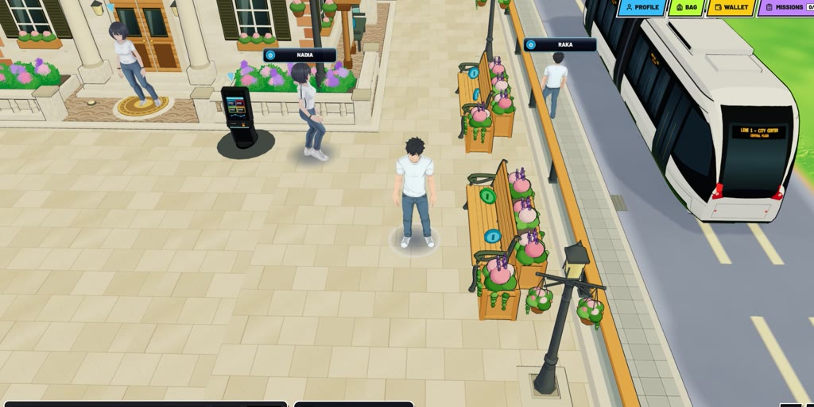 | 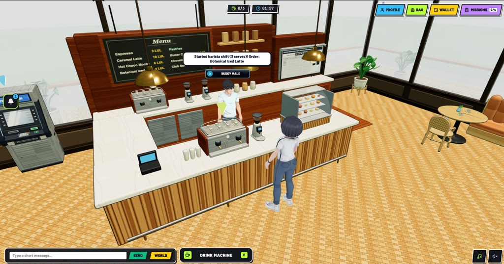 |
| 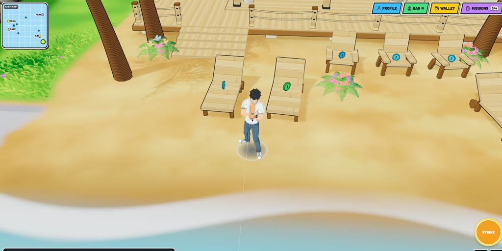 | 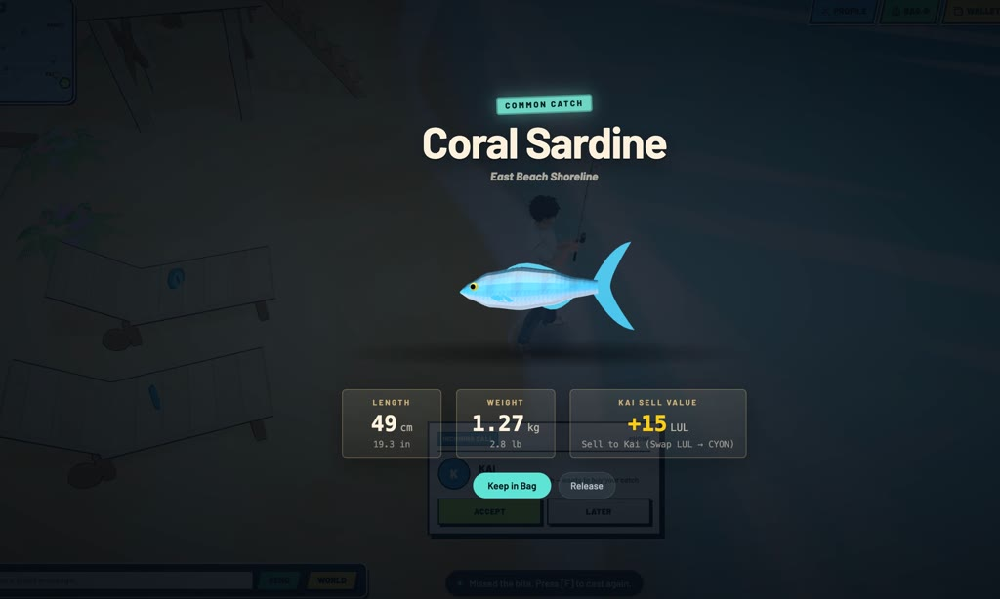 |
| 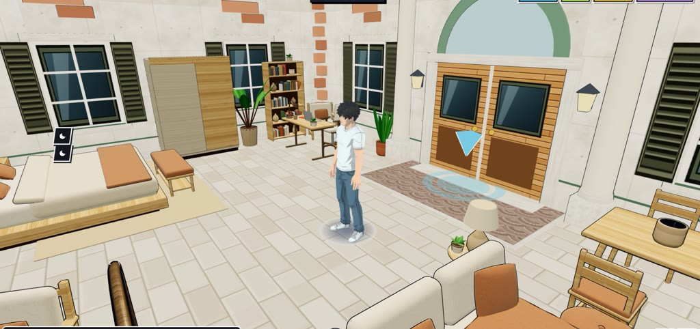 | 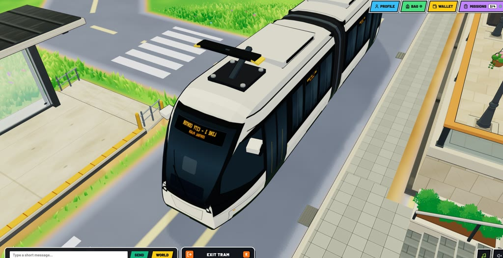 |
| 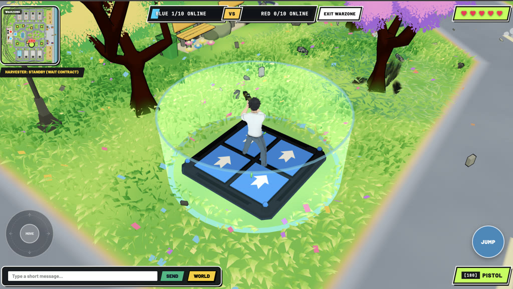 | 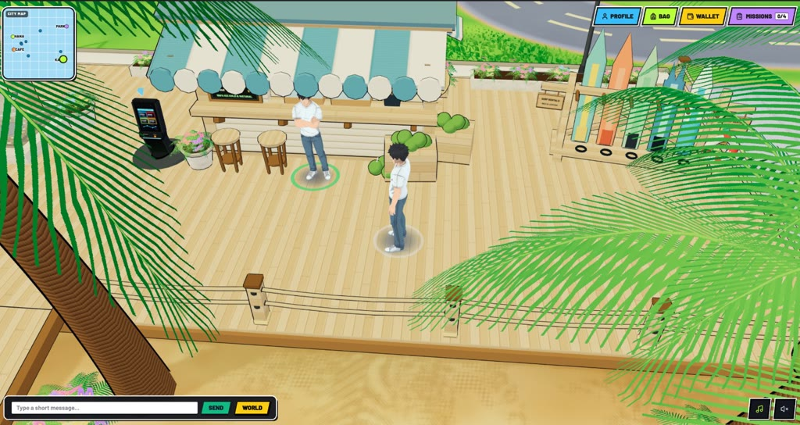 |

---

## Start playing in under a minute

1. Open the live game and choose **Continue with Google** (your in-game wallet is created for you) or **Play as Guest** to look around first.
2. Walk up to **Hana** at Central Plaza, press **E**, and claim your starter pack: **0.35 NEAR + 400 RESPITE + 100 LUL + 20 CYON**, once per account.
3. That is enough to start: work, fish, and explore right away — and 0.25 NEAR swaps to the 100 RESPITE that buys your first house.

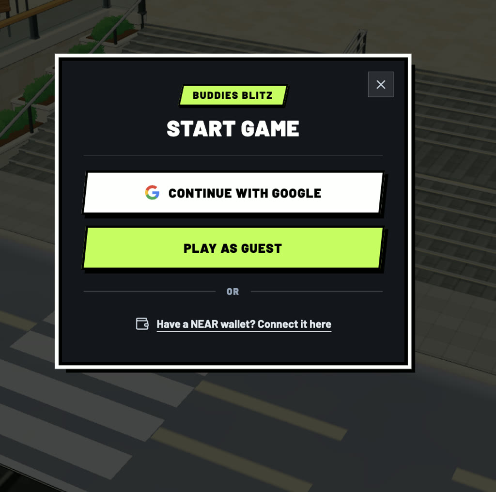

The keys you actually need: **WASD** move, **E** does almost everything (talk, board the tram, work a station, open doors, get in a vehicle, sit down), **F** fish, **Space** jump, **T** chat. The full table is further down.

## A day in Buddies

- **Morning — say hello.** Chat with Hana in any language; she explains the city, sells houses and furniture, and runs the exchange counter.
- **Get a home.** A Classic Plaza Manor costs 100 RESPITE. The deed is an NFT, the house is yours to furnish, and it earns RESPITE you can collect.
- **Work a shift.** The Glasshouse Cafe pays LUL per drink order you serve against the clock — and the NEO-STRIKE 777 slot cabinet by the windows takes LUL bets when the shift is over.
- **Afternoon — go fishing.** Ten species live in these waters. Keep a catch raw and sell it, or turn a good one into an NFT with its real species, weight, and shoreline recorded on-chain.
- **Haggle with Kai.** Kai opens below the standard price and moves up in small steps if you push — three rounds, no more. For NFT fish he pays real RESPITE from his own on-chain account.
- **Every day — four missions.** Meet Kai, work a cafe shift, catch a fish, visit your house: 200 LUL and 240 XP a day if you clear them all.
- **Evening — the Warzone.** A separate 10-vs-10 team arena with weapons, vehicles, and crate-stacking, sealed off from the peaceful city so the plaza stays a place to relax.

## Meet the merchants

**Hana — property, housing, and your guide to the city.** Her catalog sells the house deed and NFT furniture; her exchange swaps NEAR to RESPITE and LUL to CYON. Judges: everything she sells settles on-chain, and the deed she hands you carries its own earnings ledger (details under Core Design).

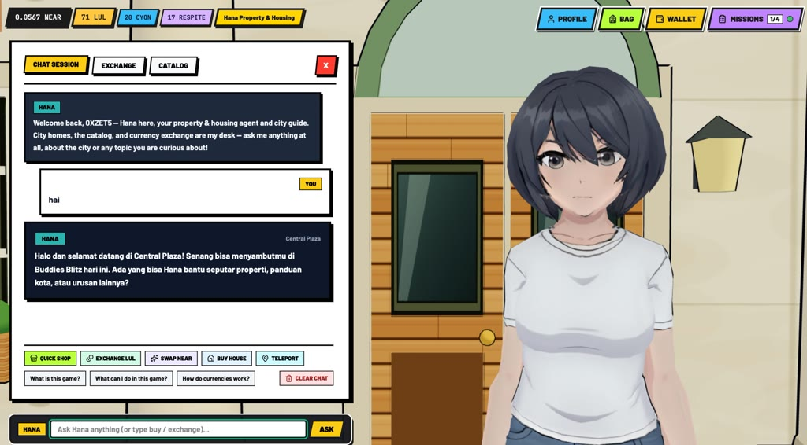
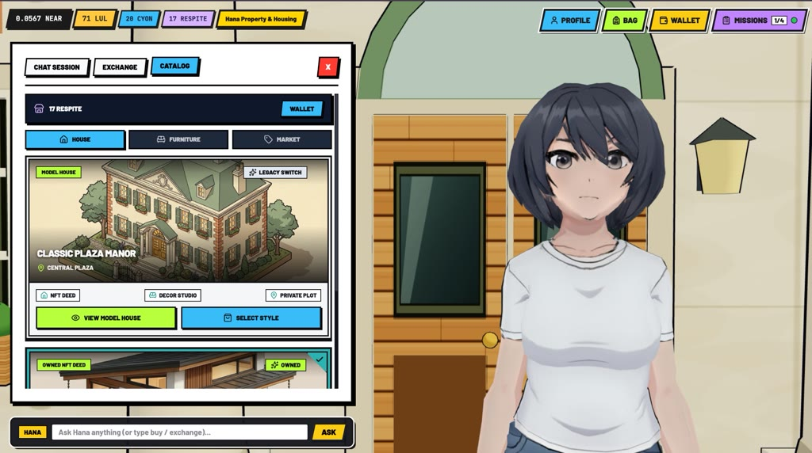

**Kai — fisherman, beach keeper, and the hardest bargain in town.** His offers are not random and not the LLM's mood: he opens at 80% of a fish's standard price, counters in fixed steps up to a hard ceiling, remembers walking away for 24 hours, and pays NFT fish from a real treasury account with daily limits and a circuit breaker. The chat is free-form and multilingual; the money math never is.

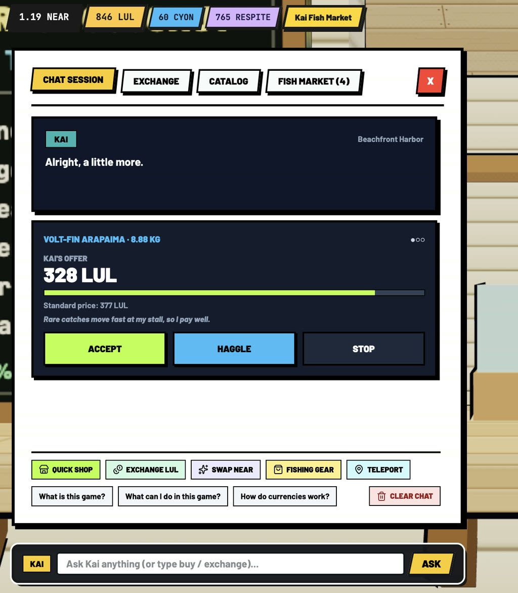
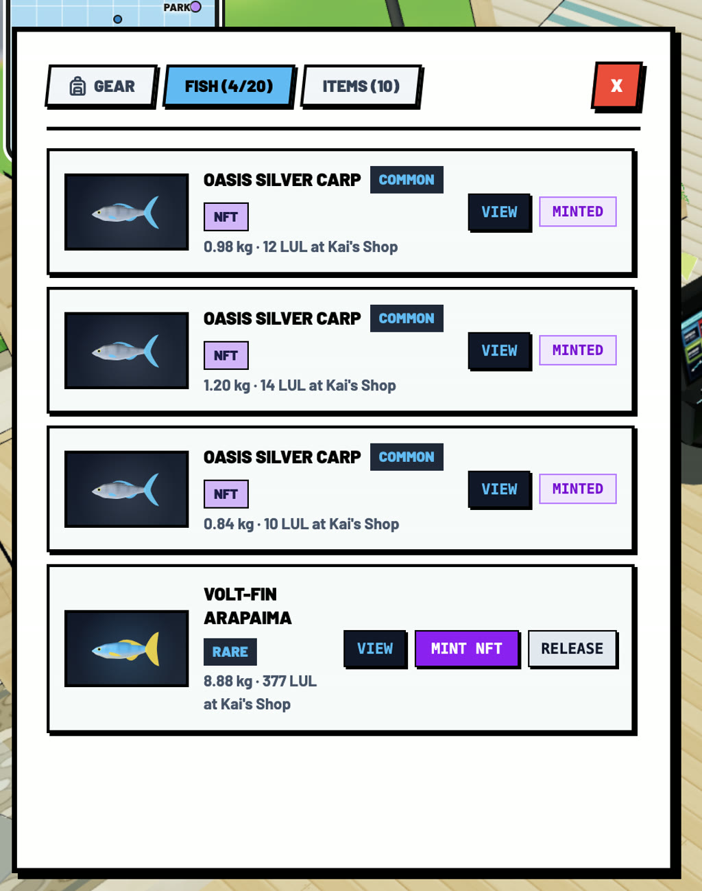

## Your house is a real deed

Buying a house mints you a deed NFT bound to its own estate account on NEAR. The house earns RESPITE over time; open the deed card to see what it earned and collect it. Furniture is NFT too — buy a piece from Hana, carry it in your Bag, place it in your studio, and it stays where you put it. Selling up? The property market holds your deed in escrow and settles the sale in one transaction, and the deed's earnings and key control pass to the buyer atomically.

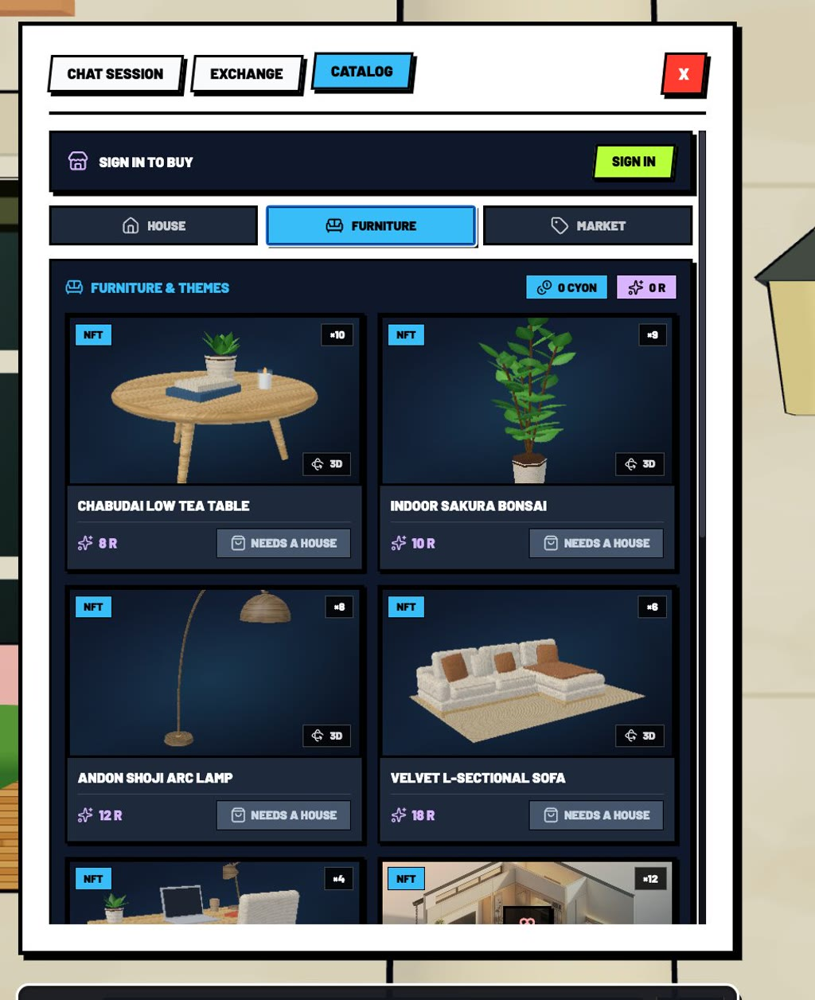

## The three currencies, in plain words

- **LUL** — play money you earn inside the game: cafe shifts, raw fish, arena drops. Spends on fun, converts to CYON. It never leaves the game.
- **CYON** — gear money, converted from LUL. Buys everyday non-NFT gear and tackle.
- **RESPITE** — the real on-chain token (NEP-141). Buys houses, NFT furniture, and NFT fish, and settles player-to-player trades. RESPITE is never printed by gameplay: it only enters by swapping NEAR, so grinding can never inflate it.

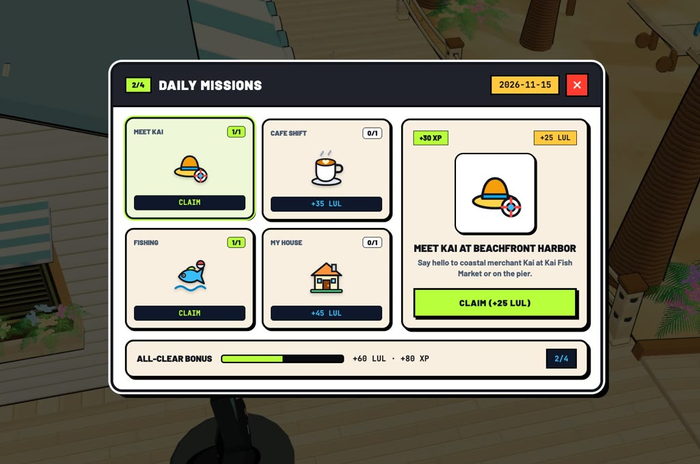
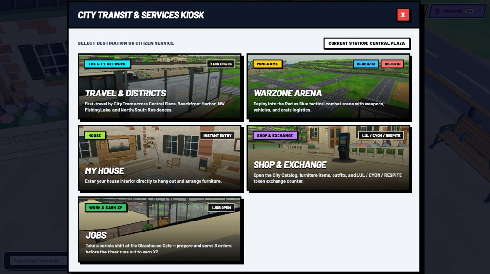

---

## For judges and developers: the systems underneath

Everything above runs on the machinery documented below — seedless sub-accounts, an attested starter grant, escrow markets, and an AI trade desk bounded by deterministic math. The verification section includes copy-paste checks against the live testnet contract and step-by-step walkthroughs of every feature shown in the screenshots.

## Core Design & NEAR Integration

### 1. Seedless Sub-Accounts & In-Game Transaction Confirmation
Players sign in with Google OAuth (via Privy), register a handle (`<handle>.buddiesblitz.testnet`), or connect **Meteor Wallet** / **MyNearWallet** with NEP-413 verification:
- **Seedless Sub-Account Provisioning**: `/api/near-relayer` creates `<handle>.buddiesblitz.testnet` and installs a browser-scoped Ed25519 `FunctionCall` key (`0.25 NEAR` allowance scoped strictly to `market.buddiesblitz.testnet`).
- **Explicit In-Game Confirmation**: Every contract write from an in-game citizen sub-wallet renders `InGameWalletConfirmModal` showing the human-readable action, target contract, attached NEAR deposit, and gas allocation before signing locally (Reject cancels cleanly without triggering external wallet popups).
- **Chain-Truth Refresh**: Account balances (`ft_balance_of`, NEAR balance) and Deed ledgers are re-queried directly from FastNEAR RPC after every transaction, overriding any cached UI numbers.

### 2. Three-Currency Anti-Bot Economy (`games`)
Traditional Web3 games either disrupt gameplay with constant wallet popups or mint tradeable tokens endlessly from repetitive grinding. Buddies Blitz isolates gameplay rewards from on-chain value:

```text
OFF-CHAIN GAMEPLAY LAYER (Zero Gas, No On-Chain Token Printing from Grinding)
  Warzone Arena + Glasshouse Cafe Jobs + Raw Caught Fish ──> LUL
                                                              │
                                                              ▼ (Exchange: 100 LUL -> 10 CYON base rate)
                                                             CYON ──> Non-NFT Catalog Gear & Tackle (Never NFT Furniture)

ON-CHAIN TREASURY & P2P OWNERSHIP LAYER (market.buddiesblitz.testnet, v1.7.0)
  NEAR Testnet ──> swap_near_for_respite() [One-Way 1 NEAR = 400 RESPITE] ──> RESPITE (NEP-141)
     ├──> purchase_citizen_asset() ──> House Ownership Deed (100 R) / Family AI Contracts (15 / 45 / 180 R)
     ├──> buy_merchant_item() / sell_merchant_item() ──> Pre-Minted NEP-245 NFT Furniture Only
     └──> Player-to-Player & NPC Treasury Settlement
            ├── Minted Fish NFTs (NEP-171): list_fish_nft / buy_fish_nft (Players or kai.buddiesblitz.testnet)
            └── Contract-Escrow Real Estate (NEP-171/NEP-245): list_property_deed / buy_property
```

| Asset | Standard / Layer | Supply Source | Permitted Sink | Security Property |
|---|---|---|---|---|
| `LUL` | Off-chain Postgres + HUD | Warzone drops, Glasshouse Cafe shifts (`+12 LUL`/order), raw fish sales | Converts only to `CYON` via NPC Exchange | Cannot withdraw or swap into `RESPITE` or `NEAR`; ground drops expire in `40s` |
| `CYON` | Off-chain Postgres + HUD | Converted from `LUL` | Standard non-NFT gear and fishing tackle | Strictly isolated from `RESPITE`; furniture is NFT-only and cannot be bought with `CYON` |
| `RESPITE` | On-chain NEP-141 / NEP-145 | One-way `swap_near_for_respite()` (`1 NEAR = 400 RESPITE`, min `0.0025 NEAR`) or P2P NFT sales | House Deeds (`100 R`), Family AI (`15/45/180 R`), NEP-245 Collector Furniture, P2P & Escrow Markets | Zero emission from gameplay grinding; live RPC `ft_balance_of` overrides UI cache |

### 3. Functional Sub-Account Deeds (`nfts`)
Every House Ownership Deed (`house-deed-*`, e.g., `house-deed-0001`) binds an on-chain `NftSubAccountLedger` record (`estate-XXXX.buddiesblitz.testnet`):
- Holds `treasury_respite`, `pending_payout_respite`, `total_earned_respite`, `total_paid_out_respite`, `key_epoch`, `active_session_key`, and an immutable `ownership_history` vector.
- Calling `authorize_deed_session_key` scopes an ephemeral key strictly to `(owner_id, key_epoch)`.
- When the Deed changes hands via `nft_transfer` or contract-escrow `buy_property`, `internal_transfer_nft_ownership` atomically increments `key_epoch`, clears `active_session_key`, transfers accumulated pending royalties intact to the buyer, and logs a `SubAccountTransferRecord`.
- Calling `claim_deed_payout(token_id, expected_key_epoch)` enforces both owner equality and `expected_key_epoch == ledger.key_epoch`, eliminating mid-payout front-running by a former owner.

### 4. Autonomous AI Merchants Bounded by Deterministic Math
Players chat in natural language (and any spoken language) with **Hana** (Central Plaza) and **Kai** (East Beach) through `/api/npc-agent` (Gemini 3.5 Flash Lite). Bounded `RESPITE` haggling sessions run through `/api/npc-trade` with **Kai** -- in person at the Fish Market, or through his in-game phone call after catching a fish:
- **Words vs. Numbers Separation**: The LLM generates conversational text only; every offer, counter-offer (+7% / +5% / +3% steps), 80% opening anchor, 115% ceiling, patience limit, and 24-hour memory/walk-away lockout is enforced deterministically in `src/game/buddiesMerchantPricing.ts` and clamped server-side inside `api/npc-trade.ts`.
- **Live NPC On-Chain Settlement**: For minted Fish NFTs, `kai.buddiesblitz.testnet` holds real on-chain `RESPITE` and signs `buy_fish_nft` with a 250 `RESPITE` per-tx cap, 1,000 `RESPITE`/day cap, 500 reserve floor, -10% daily circuit breaker, and 50% profit lock.
- **Fast-Forward Economy Simulation**: Inside Hana/Kai `EXCHANGE` and `CATALOG` tabs, clicking `FAST-FORWARD SIM` advances simulated market days in real time so judges can observe dynamic pricing pressure, restocking, and liquidity reserve protection.

---

## Security Architecture & Threat Model

| Surface | Threat Addressed | Control Implemented | Verification File |
|---|---|---|---|
| Relayer (`/api/near-relayer`) | Unauthenticated `AddKey(FullAccess)` takeover of existing `.buddiesblitz.testnet` handles | Non-strict session recovery rejects missing emails (`409 HANDLE_TAKEN`), requires valid `bb_lookup_account_by_email` match (`403 EMAIL_NOT_BOUND`), and fails closed (`503`) if identity lookup is unconfigured | [`api/near-relayer.ts`](api/near-relayer.ts), [`src/lib/nearClient.test.ts`](src/lib/nearClient.test.ts) |
| Starter Grant (`claim_hana_welcome_near_attested`) | Multi-wallet farming via fresh Google sessions or replays | Domain-separated Ed25519 attestation (`buddies-hana-claim-v1\|...`) verified on-chain via `env::ed25519_verify`, plus `claimed_hana_email_hashes` map blocking duplicate SHA-256 email claims across handles | [`api/hana-claim-attest.ts`](api/hana-claim-attest.ts), [`contracts/buddies-market/src/lib.rs`](contracts/buddies-market/src/lib.rs) |
| Fish Minting (`/api/fish-attest`) | Arbitrary client-minted trophy weights or API spam | `mint_fish_nft_attested` rejects unattested mints; `/api/fish-attest` enforces per-species weight bounds (`1.05x` max weight), expiring timestamps, and sliding-window rate limiting (`30` req/60s) | [`api/fish-attest.ts`](api/fish-attest.ts), [`src/lib/nearClient.test.ts`](src/lib/nearClient.test.ts) |
| Property Escrow & Payouts | Seller retaining asset after payment or draining royalties post-sale | `list_property_deed` moves deed into contract custody; `buy_property` swaps funds and deed atomically and bumps `key_epoch`, revoking stale claim calls | [`contracts/buddies-market/src/lib.rs`](contracts/buddies-market/src/lib.rs) |
| Database / Keys | Exposure of privileged credentials or open CORS abuse | `api/*.ts` prefers `SUPABASE_SERVICE_ROLE_KEY`, keeps `KAI_TRADE_PRIVATE_KEY` and `FISH_ATTESTER_PRIVATE_KEY` server-only, and enforces origin allowlists | [`.env.example`](.env.example), [`supabase_mvp_schema.sql`](supabase_mvp_schema.sql) |

---

## Reproducible Verification (`Do X -> See Y`)

All checks below can be executed locally without modifying any game state or secrets.

### Build & Automated Test Suite

Requirements: Node.js 18+, npm, and Rust (`stable` + `cargo-near` for WASM recompilation).

```bash
# 1. Install dependencies
npm install

# 2. Run TypeScript static check, 215 Node unit tests, and production WebGL build
npm run lint      # tsc --noEmit (0 errors)
npm test          # 215 unit tests via tsx --test (relayer auth, economy invariants, fishing, OAuth guards, arena rules)
npm run build     # Vite 8 production bundle into dist/

# 3. Run Rust smart contract unit tests & compile WASM (near-sdk 5.5.0)
cd contracts/buddies-market
cargo test                                 # 45/45 unit tests (NEP-141, P2P fish market, escrow, epoch rotation, vehicle purchases, starter grant, migrations)
cargo near build non-reproducible-wasm     # Builds target/near/buddies_market.wasm (348,564 bytes) + buddies_market_abi.json
```

### Live NEAR Testnet Contract Verification

```bash
# Verify deployed WASM code hash (expected: DzuGWw1RtF4BUwxN2HvicYgWXRxcwVe7C5Nj3XvywpRE)
curl -s -X POST https://rpc.testnet.fastnear.com -H "Content-Type: application/json" \
  -d '{"jsonrpc":"2.0","id":"1","method":"query","params":{"request_type":"view_account","finality":"final","account_id":"market.buddiesblitz.testnet"}}'

# Verify live contract overview (contract_version: "1.7.0", house_price_respite: "100", respite_per_near_rate: 400)
curl -s -X POST https://rpc.testnet.fastnear.com -H "Content-Type: application/json" \
  -d '{"jsonrpc":"2.0","id":"1","method":"query","params":{"request_type":"call_function","finality":"final","account_id":"market.buddiesblitz.testnet","method_name":"get_contract_overview","args_base64":"e30="}}'

# Query active P2P fish listings on-chain
curl -s -X POST https://rpc.testnet.fastnear.com -H "Content-Type: application/json" \
  -d '{"jsonrpc":"2.0","id":"1","method":"query","params":{"request_type":"call_function","finality":"final","account_id":"market.buddiesblitz.testnet","method_name":"get_fish_listings","args_base64":"e30="}}'
```

| Milestone | Account / TX Identifier | Explorer |
|---|---|---|
| Contract v1.5.0 Deploy | `y86KBd736RCszxeC7hzyPDiq3wy25opjYK6KUm2xyR3` | [NearBlocks](https://testnet.nearblocks.io/txns/y86KBd736RCszxeC7hzyPDiq3wy25opjYK6KUm2xyR3) |
| Contract v1.6.0 Deploy (vehicle purchases) | `2p3iJKaTPWToEAXkEbVDLKr4QChn71hzxxjPW9sPwKJS` | [NearBlocks](https://testnet.nearblocks.io/txns/2p3iJKaTPWToEAXkEbVDLKr4QChn71hzxxjPW9sPwKJS) |
| Contract v1.7.0 Deploy (starter grant 0.35 NEAR + 400 RESPITE) | `CuApSZDm51kWw5Bd5VEmYNKvFrBkVJjuuo1QYwbchYEe` | [NearBlocks](https://testnet.nearblocks.io/txns/CuApSZDm51kWw5Bd5VEmYNKvFrBkVJjuuo1QYwbchYEe) |
| State Migration (`migrate_v140_to_v150`) | `2zye3Xr1MhCRzohbagLdFbu4JwCRXbaQzVo24fpkVBy7` | [NearBlocks](https://testnet.nearblocks.io/txns/2zye3Xr1MhCRzohbagLdFbu4JwCRXbaQzVo24fpkVBy7) |
| Server-Attested Fish Mint Deploy (`v1.4.0`) | `DEJc6aPBFFyq1Yev397ipgTxDXsAf1tp9TbfUbWfMVJQ` | [NearBlocks](https://testnet.nearblocks.io/txns/DEJc6aPBFFyq1Yev397ipgTxDXsAf1tp9TbfUbWfMVJQ) |
| Escrow Property Market Deploy (`v1.3.0`) | `9MxHwwWgQFXT6CHuooqKok4kCuKvGQnYHFg87betwgHE` | [NearBlocks](https://testnet.nearblocks.io/txns/9MxHwwWgQFXT6CHuooqKok4kCuKvGQnYHFg87betwgHE) |
| Kai On-Chain Treasury Setup (`2,000 R` float) | `66eT12ikrXotwnE1mcXxGgz3CBSNPGUmVNP4G2x3ogu5` | [NearBlocks](https://testnet.nearblocks.io/txns/66eT12ikrXotwnE1mcXxGgz3CBSNPGUmVNP4G2x3ogu5) |
| Genesis Contract Init (`v1.0.0`) | `2ZPfGcyGe6pnivJE6RcM88EnLXQwG8o6Fv7hcQnaKDiL` | [NearBlocks](https://testnet.nearblocks.io/txns/2ZPfGcyGe6pnivJE6RcM88EnLXQwG8o6Fv7hcQnaKDiL) |

> **Historical Rate Note**: Earlier genesis swap and house-purchase receipts on chain occurred under pre-update development parameters; current live parameters are `1 NEAR = 400 RESPITE` and `100 RESPITE` per House Ownership Deed.

### Interactive Feature Walkthroughs (`Do X -> See Y`)

1. **Attested Starter Pack & Your First Home**
   - **Do:** Open [https://buddies-rouge.vercel.app](https://buddies-rouge.vercel.app) (or `http://localhost:3000`). Connect Google OAuth, Meteor, MyNearWallet, or create a citizen handle (`judge01`), talk to **Hana (`[E]`)** at Central Plaza, and claim the starter pack (`0.35 NEAR + 400 RESPITE + 100 LUL + 20 CYON`, once per wallet and once per Google account; Guest mode cannot claim). The city is open from the start -- nothing is gated; Walkthrough 2 below is a suggested first route, not a lock.
   - **See:** Google sign-ins invoke `/api/hana-claim-attest` + `claim_hana_welcome_near_attested`, recording an immutable email hash on-chain and displaying your transaction proof strip. Balances re-read directly from NEAR RPC after confirmation.
2. **Swap `NEAR -> RESPITE`, Buy Deed, Furnish Studio, and Inspect Sub-Account Ledger (`nfts`)**
   - **Do:** Your starter pack already holds `400 RESPITE`, so walk to the **Real Estate Kiosk** by the plaza and purchase **House Ownership (`100 RESPITE`)** plus one piece of **NFT Furniture** (`RESPITE` / NEP-245). **Hana -> `EXCHANGE`** swaps NEAR for more RESPITE at `400` per NEAR whenever you need it. Enter with **`GO TO YOUR HOUSE`** (`CONFIRM MOVE` after placing furniture), then open **`WALLET -> MY ITEMS`**.
   - **See:** Your House Deed card displays the real minted Deed ID (e.g., `house-deed-0001`), linked sub-account (`estate-0001.buddiesblitz.testnet`), active **`EPOCH #N`**, Pending/Earned/Paid Out RESPITE counters, Provenance History, and functional **`FUND +5 R`** / **`CLAIM PAYOUT`** on-chain buttons. Under the kiosk's `PROPERTY MARKET` tab, real estate and NFT furniture listings settle atomically via contract escrow (`list_property_deed` -> `buy_property`), and each settlement issues a receipt Letter under `Social Chat -> PRIVATE`.
3. **Daily Missions (`games`)**
   - **Do:** Open the **`MISSIONS`** board from the HUD and complete the day's five missions: **Meet Kai** at the Fish Market, **Work a Shift** at Glasshouse Cafe, **Catch a Fish**, **Claim Your Plot** at the residences, and **Visit Your Claimed Plot House**. Every mission's `GO` button lights a golden waypoint path to its first stop (a transit kiosk for the far ones, then on to the target after the tram).
   - **See:** Progress records automatically from real gameplay events -- chatting with Kai, serving a cafe order, landing a catch, stepping into your own house. Rewards are off-chain `LUL` + `XP` (`25/30`, `35/40`, `35/40`, `40/45`, `45/50` per mission) plus a `+60 LUL / +80 XP` all-clear bonus, for a maximum of `240 LUL + 285 XP` per day -- `RESPITE` is never emitted from gameplay grinding. Mission state is stored per wallet account and resets on the player's local calendar day.
4. **Shoreline Fishing, Attested NFT Minting & Bounded AI Haggling (`games`)**
   - **Do:** Ride the tram (`[E]`) or take **City Transit Kiosk (`[E]`) -> `KAI FISH MARKET`**, equip the **Fishing Rod** (`BAG`), hold **`F`** near East Beach water, complete the **Line-Tension Gauge** catch, open **`BAG -> FISH`** to mint a Fish NFT (`/api/fish-attest`), and talk or haggle with **Kai (`[E]`)** or answer his phone call in any language.
   - **See:** Minting writes on-chain species, zone, rarity, and weight attributes verified by Ed25519 signature. Haggling runs deterministic step/ceiling logic while allowing `kai.buddiesblitz.testnet` to buy qualifying Fish NFTs with real on-chain `RESPITE`.
5. **Glasshouse Cafe Barista Shift, NEO-STRIKE Slots & Separated 4v4 Warzone Arena**
   - **Do:** Enter **Glasshouse Cafe** inside Central Plaza to prepare 3 drink orders (`+12 LUL` each), then play the **NEO-STRIKE 777 Slots** cabinet by the cafe windows. Return to the **Transit Kiosk (`[E]`) -> `WARZONE ARENA`**, pick **`BLUE TEAM`** or **`RED TEAM`**, stack crates on `2x2x2` team pads, and press **`EXIT WARZONE`** when finished.
   - **See:** The slot cabinet takes `LUL` bets (`2 / 5 / 10 / 25`) on weighted 32-stop reels and pays entirely in off-chain `LUL`: `7-7-7` jackpot `50x`, triple Diamond `20x`, Star `12x`, Bell `8x`, Coffee `5x`, Cherry `3x`, with pair pays up to `4x`. Combat weapons, crates, and Family Member AI squad companions operate exclusively inside the Warzone arena, never inside the peaceful city plaza.

---

## Controls

| Key | Action |
|---|---|
| `W A S D` / Arrow Keys | Move character, swim, or drive vehicle |
| `Space` | Jump (Main World & Warzone) |
| `E` | Interact: Hana/Kai, Transit Kiosk, board/exit the Street Tram, Cafe stations, house doors, sit/stand in the city, mount/dismount Warzone vehicles (Tank, Truck, Plane), or pick up/throw crates in Warzone |
| `F` | Cast / reel Fishing Rod by shoreline or assemble active `2x2x2` pad recipe in Warzone |
| `Q` | Cycle active `2x2x2` crate recipe hologram on base pad |
| `B` | Open Tactical Base Kiosk (`Armory` / `Hangar`) or Plot Claim panel |
| `T` | Open World & Private Whisper Chat (`Messages`, `Letters`, online list) |
| `Esc` | Close active modal or cancel cast |

---

## Repository Layout

```text
api/
  fish-attest.ts                        Serverless Ed25519 catch attestation (mint_fish_nft_attested + rate limit)
  hana-claim-attest.ts                  Serverless Ed25519 starter-claim attestation + email hash deduplication
  near-relayer.ts                       Dual-key citizen sub-account provisioner + email-verified session recovery
  npc-agent.ts                          Gemini 3.5 Flash Lite multilingual NPC dialogue concierge for Hana & Kai
  npc-trade.ts                          Bounded RESPITE negotiation sessions + kai.buddiesblitz.testnet settlement

contracts/buddies-market/
  Cargo.toml                            near-sdk 5.5.0 manifest
  src/lib.rs                            NEP-141/145, NEP-171/177/181, Sub-Account Deeds, Escrow, NEP-245 (v1.7.0)
  target/near/                          Compiled buddies_market.wasm (348,564 B) + buddies_market_abi.json

src/
  App.tsx                               HUD, Wallet MY ITEMS/HISTORY, Sub-Account Deed Ledger UI, Bag, Daily Missions state
  components/
    CharacterProfileModal.tsx           Citizen identity & balance modal
    CityTransitKioskModal.tsx           Portal Hub: Travel & Districts, Warzone Faction Select, My House, Shop
    Fish3dPreviewModal.tsx              360-degree Three.js fish inspector
    Furniture3dPreviewModal.tsx         3D interior catalog item inspector
    GlasshouseCafeModal.tsx             Barista job shift mini-game (+12 LUL/order)
    GlasshouseCafeSlotModal.tsx         NEO-STRIKE 777 arcade slots cabinet (LUL bets & payouts)
    DailyMissionsModal.tsx              Daily missions board: progress, reward claims & transit shortcuts
    InGameWalletConfirmModal.tsx        On-chain transaction signer confirmation sheet
    MobileResponsiveControls.tsx        Touch joysticks & responsive orientation guard
    NearWalletSelectorModal.tsx         Handle registration + Meteor / MyNearWallet NEP-413 connection
    NpcMerchantAndHouseModal.tsx        Hana/Kai Dialogue, Exchange + FAST-FORWARD SIM, Catalog, Escrow Market, Studio
    ShorelineCatchShowcaseModal.tsx     Tension-gauge catch summary
    SocialChatModal.tsx                 Global chat, whispers, and on-chain ownership/sales Letters
    TacticalKioskModal.tsx              Warzone Armory, Vehicle Hangar, and Residential Plot claim UI
  game/
    BuddiesBlitzArena.tsx               Unified Three.js engine, peaceful city isolation & Warzone loop
    buddiesBlitzRules.ts                Crate stacking recipes, match win conditions, plot & transit rules
    buddiesMerchantPricing.ts           Deterministic NPC negotiation math, dynamic catalog & house rules
    buddiesFishingMarket.ts             Shoreline habitat tables, cast/tension mechanics & P2P market types
    buddiesArcadeSlots.ts               NEO-STRIKE slot odds, bet tiers & LUL payout math
    buddiesDailyMissions.ts             Daily mission catalog, per-account progress & local-day reset
    buddiesInteriorAssets.ts            Pavilion architectural studio & OBB furniture placement
    buddiesBlitzWorldBuilder.ts         Coastal city geometry, tram line & Warzone map builder
    buddiesBlitzSquadAi.ts              Octile A* pathfinding & Warzone-only Family Member companion AI
    buddiesAmusementParkBuilder.ts      Harbor amusement district structures and animated rides
    buddiesCafeInteriorBuilder.ts       Glasshouse Cafe interactive interior layout
    audio.ts                            Procedural Web Audio synthesizer
  lib/
    nearClient.ts                       FastNEAR JSON-RPC helpers, Ed25519 key management & contract calls
    supabaseClient.ts                   PostgreSQL persistence, market event feed & realtime multiplayer channel
    privyAuthBridge.tsx                 Headless Google OAuth bridge & injected wallet safety wrappers

supabase_mvp_schema.sql                 Idempotent PostgreSQL tables, RLS policies, views & atomic RPCs
```

---

## Local Setup & Environment Variables

1. Copy [`.env.example`](.env.example) to `.env`.
2. Initialize your Supabase project by running [`supabase_mvp_schema.sql`](supabase_mvp_schema.sql) in the Supabase SQL Editor.
3. Configure public Vite variables (`VITE_NEAR_NETWORK`, `VITE_NEAR_RPC_URL`, `VITE_NEAR_MARKET_CONTRACT_ID`, `VITE_PRIVY_APP_ID`, `VITE_SUPABASE_URL`, `VITE_SUPABASE_ANON_KEY`) and server-only API variables (`NEAR_MASTER_PRIVATE_KEY`, `FISH_ATTESTER_PRIVATE_KEY`, `HANA_CLAIM_ATTESTER_PRIVATE_KEY`, `KAI_TRADE_PRIVATE_KEY`, `GEMINI_API_KEY`, `SUPABASE_SERVICE_ROLE_KEY`, `SUPABASE_URL`) in Vercel Project Settings or local `.env`.
4. Run `npm run dev` and open `http://localhost:3000`.

---

## Acknowledgments & License

- **License**: Released under the [MIT License](LICENSE).
- **Open-Source Attribution**: Shoreline fishing bite scheduling, line-tension fight mechanics, catch showcase flow, and analytical multi-cascade wave evaluation were adapted from the MIT-licensed project **Tidewater** by Dan Greenheck (DRG Software Solutions LLC, [https://github.com/dgreenheck/tidewater](https://github.com/dgreenheck/tidewater)). Full license text and file-level attribution are documented in [`THIRD-PARTY-NOTICES.md`](THIRD-PARTY-NOTICES.md).
- **Prior Hackathon Baseline**: `CettaC1716/buddies` is the sole hackathon submission repository, consolidating an earlier Nov 5-8 prototype branch created within the NEAR Hackathon 2026 development window.
