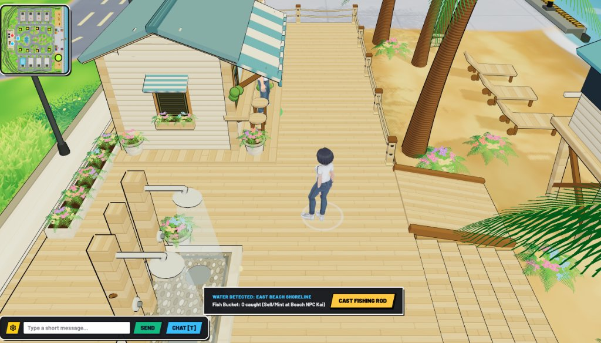
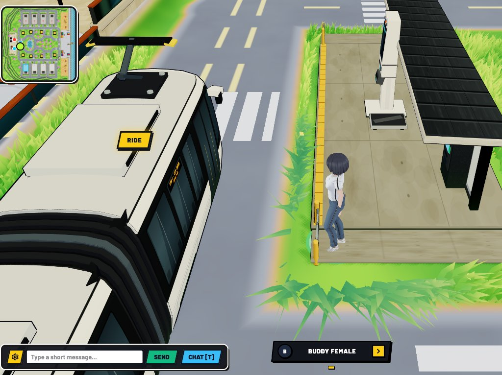
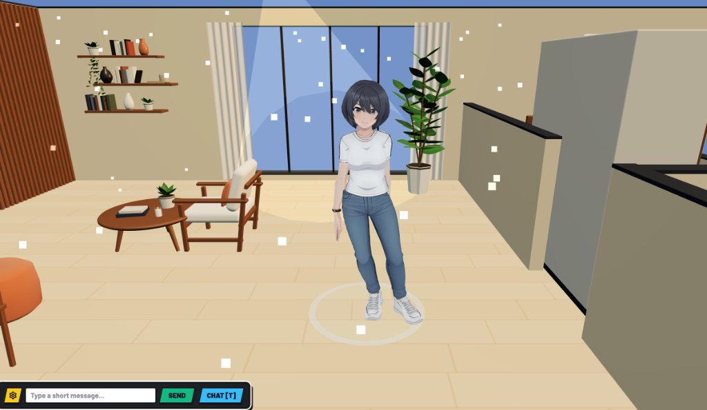
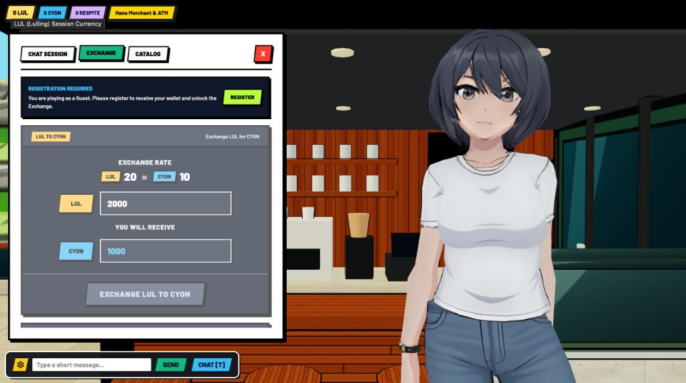
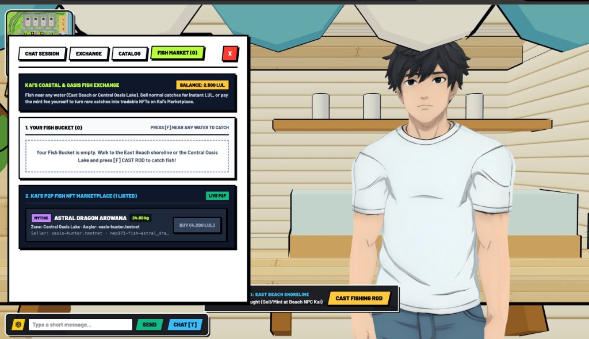
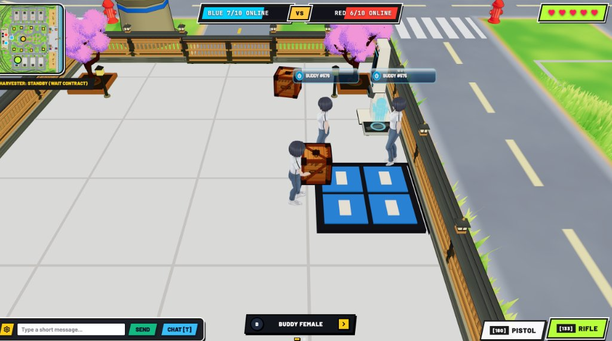
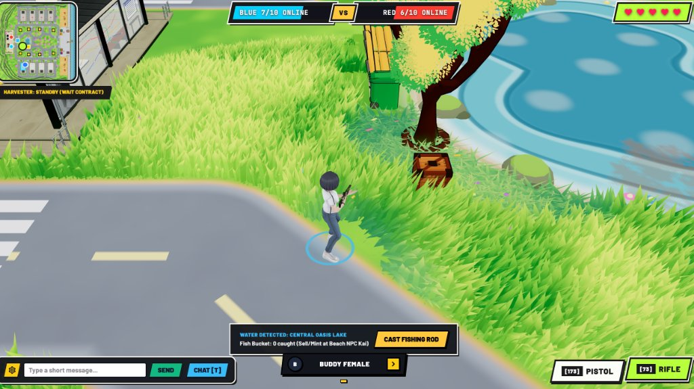
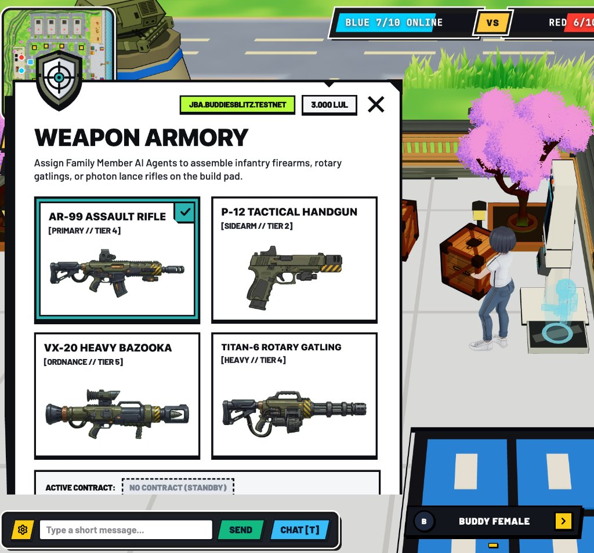
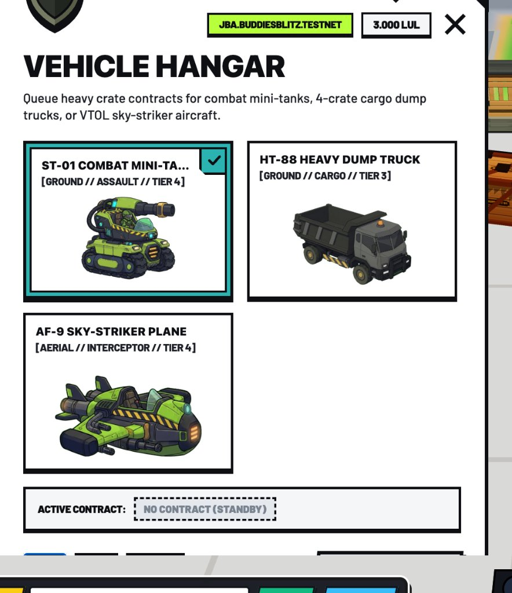

# Buddies Blitz

A 60 FPS WebGL 3D social city, shoreline fishing ground, and crate-stacking tactical arena built in Three.js and React 19, paired with seedless NEAR Protocol sub-accounts (`<name>.buddiesblitz.testnet`) and an on-chain P2P Fish NFT marketplace (`market.buddiesblitz.testnet`).

Live deployment: **[https://buddies-rouge.vercel.app](https://buddies-rouge.vercel.app)**



| | |
|---|---|
|  |  |
|  |  |

---

It opens on a hexagonal comic-cutout title frame and steps into a three-zone world that shares one continuous character rig, lighting pipeline, and spatial chat layer:

1. **Mini Cafe Lobby (`worldMode = 'lobby'`)** — A peaceful arrival plaza centered around Nadia's cafe kiosk (`(0, -14)`), flanked by two transit portals: the **Safezone City** gate to the west and the **Red / Blue Warzone** deployment terminal to the east.
2. **Safezone City (`worldMode = 'safezone'`)** — A non-combat coastal town where weapons are holstered (`combatHudVisible = false`). A central boulevard runs past Commander residential plots, the **Central Oasis Lake** (`radius = 19 m`), private cutaway houses you can step inside and furnish, and the **East Beach Shoreline** (`x > 52 m`), where Merchant Kai runs the tackle dock and the player-to-player Fish NFT marketplace.
3. **Warzone Arena (`worldMode = 'warzone'`)** — A full *Team Buddies*-inspired Red vs Blue battlefield. Supply crates parachute onto neutral drop pads; carrying and stacking crates onto your base's 8-slot `2x2x2` crafting grid (`1x1x1`, `1x1x2`, `2x1x1`, `2x2x1`, `2x2x2`) fabricates weapons, infantry buddies, tanks, and super vehicles to breach the opposing headquarters.

Requires Node 18+ and npm.

```bash
npm install
npm run dev      # Vite dev server on http://localhost:3000 (includes local NEAR sub-account middleware)
npm run build    # TypeScript check + production bundle into dist/
```

| key | action |
|---|---|
| `W A S D` / `Arrow Keys` | walk / drive vehicle |
| `Space` | jump |
| `E` | grab or throw crate (Warzone) / talk to nearest NPC merchant (`Hiro`, `Hana`, `Kai`) |
| `F` | cast fishing rod & reel in catch (near East Beach or Central Oasis Lake) / craft stacked pad recipe (Warzone) |
| `Q` | cycle active `2x2x2` ghost hologram recipe on base pad |
| `B` | open self-service Tactical Base Kiosk when standing near your base terminal |
| `T` | open 3-column MMORPG Social & Whisper Chat modal |
| `V` | toggle AI Binoculars / tactical overview |
| `M` | mute / unmute procedural Web Audio engine |
| `L` | cycle atmospheric lighting preset (`day`, `sunset`, `night`) |
| `C` | toggle camera FOV preset |
| `Esc` | close active modal or pause |

**Where to walk:** From the Lobby spawn, walk toward the **Safezone City** terminal on the left to enter the coastal city. Walk east (`x > 52`) until the tarmac gives way to sand and timber piers — the shoreline detector (`detectNearbyFishingWaterZone` in [`src/game/buddiesFishingMarket.ts`](src/game/buddiesFishingMarket.ts)) lights up the fishing bar as soon as you reach the water's edge or the Central Oasis Lake (`(0, 0)`). Press `F` to cast your bobber, wait for the strike, and press `F` again to land the fish. Unwanted common catches can be released immediately back into the water from the catch banner (`RELEASE`) so your 20-slot fish bucket never clogs; valuable catches can be carried to **Merchant Kai** on the beach pier to sell for off-chain `CYON` or minted on-chain as a **NEP-171 Fish NFT** to trade with other citizens for `RESPITE`.

---

## How the 3D arena and dual-mode world are built

The 3D viewport is driven by a single imperative Three.js loop in [`src/game/BuddiesBlitzArena.tsx`](src/game/BuddiesBlitzArena.tsx), decoupled from React's render cycle so HUD updates never stall frame pacing.

**Clean scene remount per world mode** — `src/App.tsx` & `src/game/BuddiesBlitzArena.tsx`
Switching between `lobby`, `safezone`, and `warzone` keys the `<BuddiesBlitzArena />` mount (`key={`${worldMode}-${worldTransitionCount}`}`) behind a deterministic transition barrier. Every geometry buffer, shadow map, and skeletal mixer from the previous zone is disposed before the next zone's procedural builders run.

**Peaceful state invariant** — `src/game/buddiesBlitzRules.ts`
`evaluateLobbyAndSafezonePeacefulState()` enforces a strict separation between social zones and combat zones. When `worldMode` is `'lobby'` or `'safezone'`, enemy AI spawners, projectile hitboxes, crate drop timers, and the 5-lives Warzone health bar are disabled at the rule-engine level rather than merely hidden in CSS.

**Two-stage character targeting** — `src/App.tsx`
Clicking any 3D character (yourself, a nearby player, or an NPC merchant) raycasts against the character capsule and opens a compact black name bar at the bottom-center of the screen. Clicking the name bar expands context-specific actions:
- **Self (`YOU`)**: `PROFILE` and `WALLET`
- **Other Citizen / NPC**: `TALK`, `PROFILE`, and `WHISPER`

**Fixed-pool particle emitter** — `src/components/ParticleEmitterPanel.ts`
Muzzle flashes, crate merge bursts, water splashes, and portal rings draw from a pre-allocated 128-particle ring buffer. No `THREE.Mesh` or `Vector3` allocations occur during active combat or fishing.

---

## The 8-slot `2x2x2` crate stacking pad

In the Warzone (`worldMode = 'warzone'`), each base owns an 8-slot (`2x2x2`) stacking pad governed by [`src/game/buddiesBlitzRules.ts`](src/game/buddiesBlitzRules.ts):

```text
Bottom Layer (y = 0)     Top Layer (y = 1)
  [0]  [1]                 [4]  [5]
  [2]  [3]                 [6]  [7]
```

Instead of buying units from a flat shop menu during battle, players select a priority recipe at their Tactical Kiosk (`Q` or `B`). The pad projects colour-coded ghost holograms over the exact slots required by that shape:
- **`1x1x1` (1 crate)** — Light firearms (`uzi`, `shotgun`, `grenade`)
- **`1x1x2` (vertical column, 2 crates)** — Autonomous squad buddies (`Infantry`, `Bazooka`, `Commando`)
- **`2x1x1` (horizontal bar, 2 crates)** — Heavy weapons & support gear
- **`2x2x1` (flat 4-crate base)** — Light combat vehicles
- **`2x2x2` (full 8-crate cube)** — Heavy tanks and super air support

When a crate is thrown onto a glowing hologram slot, the pad validates the 3D occupancy bitmask and resolves the recipe in place.

| | |
|---|---|
|  |  |
|  |  |

---

## Economy architecture: anti-bot separation & Roblox *Fisch*-style trading

A common failure mode of Web3 games is putting every grindable activity loop on-chain, which invites automated bots to farm combat or fishing loops and drain token liquidity. Buddies Blitz prevents this by splitting the economy into **strictly off-chain social currencies** and **on-chain collectibles** (`contracts/buddies-market/src/lib.rs`).

```text
OFF-CHAIN (Supabase PostgreSQL — Zero On-Chain Liquidity Risk)
  Warzone Crates & Combat ──► LUL ──► Exchange at NPC ──► CYON (Outfits & Casual Decor)
  Common / Unminted Fish  ──────────► Sell to NPC Kai ──► CYON (or RELEASE to free bag space)

ON-CHAIN (NEAR Testnet: market.buddiesblitz.testnet)
  NEAR Testnet ──► swap_near_for_respite() ──► RESPITE
  Rare Caught Fish ──► mint_fish_nft() ──► list_fish_nft() ◄──► buy_fish_nft() (Paid in RESPITE)
  RESPITE ──► purchase_citizen_asset() ──► Private House Deed & Family Member AI Contracts
```

### 1. Off-chain currencies (`LUL` and `CYON`)
- **`LUL` (Lulling)** is earned exclusively inside the **Warzone** from combat objectives and crate harvesting. New accounts start at `0 LUL`.
- **`CYON` (Halcyon)** is obtained either by exchanging `LUL -> CYON` at the Merchant (`20 LUL = 10 CYON`) or by selling unminted fish directly to Merchant Kai at the beach (`SELL TO MERCHANT`).
- **One-way firewall:** Neither `LUL` nor `CYON` exists in the NEAR smart contract, and neither can ever be converted into `RESPITE` or `NEAR`. Bot farming in the Warzone has zero path to extract on-chain value.

### 2. Shoreline fishing, bag management (`20/20`), and `RELEASE`
Fishing works at two water bodies in Safezone City (`src/game/buddiesFishingMarket.ts`):
- **East Beach Shoreline (`x > 52`)** — Saltwater table (*Silver Sardine*, *Coral Clownfish*, * Reef Barracuda*, *Golden Hammerhead*, *Abyssal Leviathan*).
- **Central Oasis Lake (`radius <= 19 m`)** — Freshwater table (*Oasis Koi*, *Emerald Bass*, *Electric Catfish*, *Sakura Sturgeon*, *Celestial Arowana*).

Each player carries a **20-fish bucket (`caughtFishBucket.length / 20`)**. When a fish is landed:
- If it is a low-weight `Common` catch that would only clutter the bucket, the player can click **`RELEASE`** directly on the shoreline catch toast (or **`RELEASE` / `RELEASE COMMON`** inside Kai's bucket panel) to throw it back into the water.
- If the player wants casual currency for clothes or furniture, they click **`SELL TO MERCHANT (+X CYON)`** (off-chain).
- If the player lands a heavy `Rare` or `Mythic` specimen, they click **`MINT FISH AS NFT`**, minting a **NEP-171 Fish NFT** with its exact `species_id`, `weight_kg`, and `rarity`, and list it on the **Player Fish NFT Marketplace** for **`RESPITE`**.

### 3. On-chain smart contract (`market.buddiesblitz.testnet`)
The Rust smart contract in [`contracts/buddies-market/src/lib.rs`](contracts/buddies-market/src/lib.rs) (built on `near-sdk` v5) is deployed to **`market.buddiesblitz.testnet`** (`Tx: LNiV8vsywXs2rX9TB4CWoZmgrU7dDtFw2RLvtnL7DLq`) under the master account **`buddiesblitz.testnet`** (`Tx: Gn2K6j8WEuN11Rjm3eJAziJ5Y45H8ym1DYicw9m7WXi7`):

- `swap_near_for_respite()` (`#[payable]`) — Accepts native Testnet `NEAR` and credits on-chain `RESPITE` (`1 NEAR = 100 RESPITE`).
- `mint_fish_nft(token_id, species_id, species_name, water_zone, rarity, weight_kg_x100)` — Mints a NEP-171 Fish NFT to `env::predecessor_account_id()` and emits a standard `EVENT_JSON` (`nep171` `nft_mint`).
- `list_fish_nft(listing_id, token_id, price_respite)` — Places the caller's Fish NFT on the P2P order book for `RESPITE`.
- `buy_fish_nft(listing_id)` — Atomically transfers `price_respite` from buyer to seller, transfers `owner_id` of the Fish NFT to the buyer, and emits `EVENT_JSON` (`nep171` `nft_transfer`).
- `purchase_citizen_asset(asset_id, price_respite)` — Deducts `RESPITE` to unlock Private House ownership (`25 RESPITE`) or recruit an autonomous **Family Member** AI contract (`15 / 45 / 180 RESPITE` for `1 Week / 1 Month / 1 Year`).

---

## Seedless citizen onboarding (`Privy Google OAuth -> <name>.buddiesblitz.testnet`)

Players never deal with seed phrases or browser extension popups during normal gameplay:

1. **Google authentication via Privy (`@privy-io/react-auth`)** — Clicking **`CONTINUE WITH GOOGLE`** on the start screen (or **`REGISTER`** inside any Merchant modal while playing as a Guest) opens Privy's Google OAuth flow (`src/main.tsx`, `src/App.tsx`).
2. **Custom wallet naming** — Once Google returns the player's verified email, the in-game **`Choose your wallet name`** modal opens with an empty input field so the player types their own handle (or clicks `RANDOM LETTERS` for a 6-letter code), previewing `<name>.buddiesblitz.testnet` in real time.
3. **Hierarchical sub-account provisioning** — `spawnSubAccountOnChainViaMaster()` in [`src/lib/nearClient.ts`](src/lib/nearClient.ts) provisions `<name>.buddiesblitz.testnet` under the parent master account `buddiesblitz.testnet` with Dual-Key custody (`masterFullAccessKey` + `playerSessionKey`), transitions through `Please wait, preparing your wallet...`, and unlocks the city with `Welcome Citizen, your wallet is now active.`

---

## Project structure

```text
src/
  main.tsx                              PrivyProvider (Google OAuth) & React 19 root mount
  App.tsx                               HUD, onboarding state machine, fishing bar, modals & sync
  game/
    BuddiesBlitzArena.tsx               Three.js WebGL renderer, 3 zones, physics & 60 FPS loop
    buddiesBlitzRules.ts                2x2x2 pad recipes, peaceful-zone rules, radar & constants
    buddiesMerchantPricing.ts           NPC catalog items, dynamic LUL->CYON quotes & stock ticks
    buddiesFishingMarket.ts             Water-zone detector, fish rarity tables & P2P listings
    audio.ts                            Procedural Web Audio synthesizer for UI & combat SFX
  components/
    NpcMerchantAndHouseModal.tsx        NPC dialogue, Exchange, Catalog, Fish Bucket & Cutaway House
    TacticalKioskModal.tsx              Warzone recipe queue, base upgrades & plot access control
    SocialChatModal.tsx                 3-column nearby players list, public chat & whisper UI
    CharacterProfileModal.tsx           Citizen profile card, balances & username editor
    NearWalletSelectorModal.tsx         External NEAR wallet selector & RPC account verifier
    AdminCommandDashboard.tsx           Master treasury & sub-account custody dashboard
    ParticleEmitterPanel.tsx            Fixed-pool 128-particle studio tuner
    MobileResponsiveControls.tsx        Touch virtual joystick & landscape orientation guard
  lib/
    nearClient.ts                       NEAR JSON-RPC client, sub-account engine & swap receipts
    supabaseClient.ts                   Supabase PostgreSQL persistence & Realtime broadcast channel

contracts/
  buddies-market/
    Cargo.toml                          near-sdk 5.5 Rust manifest for market.buddiesblitz.testnet
    src/lib.rs                          On-chain RESPITE, NEP-171 Fish NFT & P2P Marketplace contract

docs/
  hero-1-beach-pier.jpg                 East Beach shoreline boardwalk & fishing prompt
  hero-2-tram-station.jpg               Safezone City articulated tram & transit shelter
  hero-3-house-interior.jpg             Private citizen house cutaway interior
  hero-4-hana-exchange.jpg              Hana's Lobby Cafe & off-chain LUL -> CYON exchange
  hero-5-kai-fish-market.jpg            Merchant Kai's fish bucket & P2P Fish NFT marketplace
  hero-6-oasis-lake.jpg                 Central Oasis Lake fishing & Warzone HUD
  hero-7-crate-stacking-pad.jpg         2x2x2 base crate pad & Family Member AI buddies
  hero-8-weapon-armory.jpg              Tactical Base Kiosk Weapon Armory modal
  hero-9-vehicle-hangar.jpg             Tactical Base Kiosk Vehicle Hangar modal
```

---

## Environment variables

Create a `.env` file in the project root (or configure in Vercel Project Settings):

| variable | description |
|---|---|
| `VITE_PRIVY_APP_ID` | Privy App ID configured with Google OAuth enabled (`cmw9085hh004s0hl29d6ts78f`). |
| `VITE_SUPABASE_URL` | Supabase project URL (`https://<project-ref>.supabase.co`). |
| `VITE_SUPABASE_ANON_KEY` | Supabase public `anon` API key. |
| `VITE_NEAR_NETWORK` | NEAR network target (`testnet` by default). |
| `VITE_NEAR_RPC_URL` | NEAR JSON-RPC endpoint (`https://rpc.testnet.near.org`). |

To initialize a fresh Supabase database for off-chain profiles, house interiors, and realtime chat, run [`supabase_mvp_schema.sql`](supabase_mvp_schema.sql) in the Supabase SQL Editor.

## Building and deploying the NEAR smart contract

With [`near-cli-rs`](https://docs.near.org/) and [`cargo-near`](https://github.com/near/cargo-near) installed:

```bash
cd contracts/buddies-market
cargo near build non-reproducible-wasm

near contract deploy market.buddiesblitz.testnet \
  use-file target/near/buddies_market.wasm \
  with-init-call init \
  json-args '{"master_account":"buddiesblitz.testnet"}' \
  prepaid-gas '100.0 Tgas' \
  attached-deposit '0 NEAR' \
  network-config testnet \
  sign-with-legacy-keychain \
  send
```
